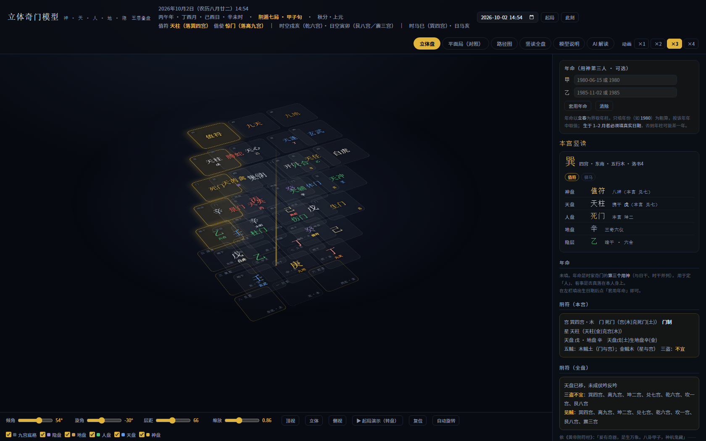
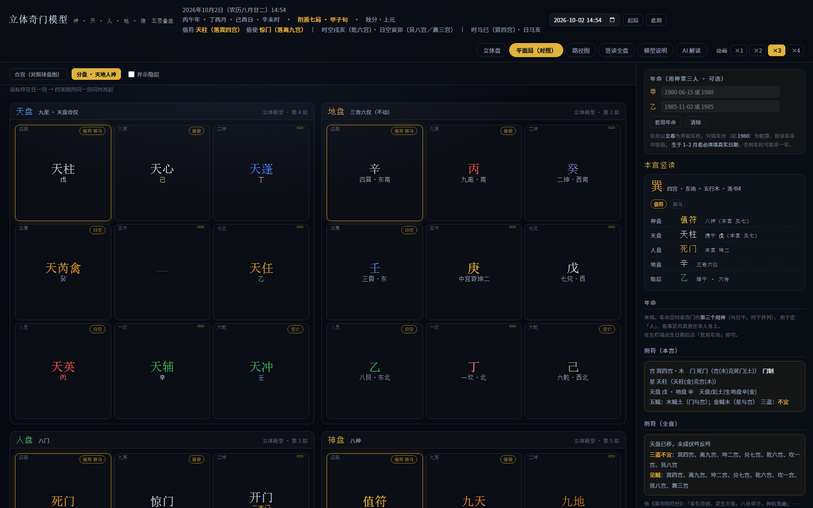
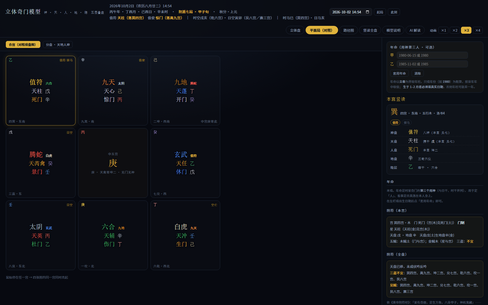
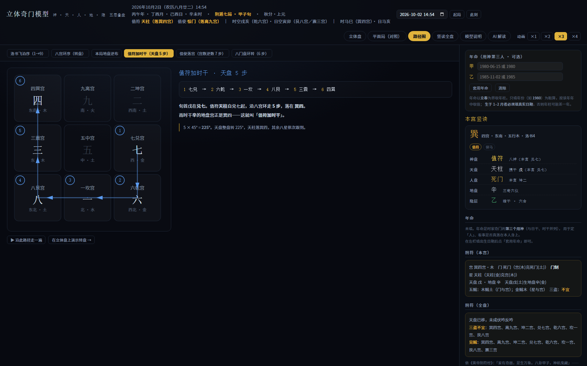
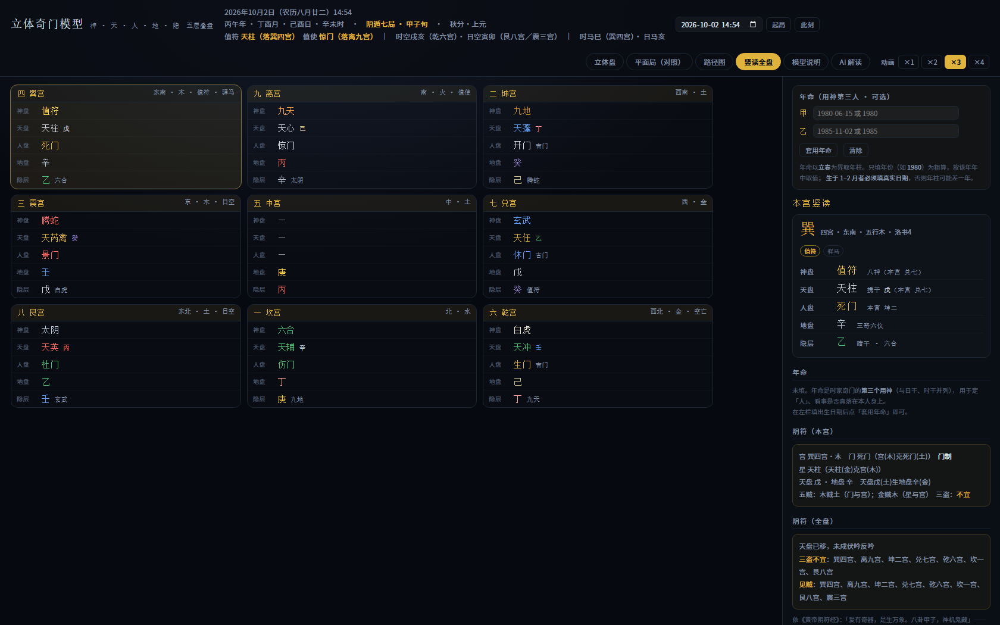

# qimen

在 Obsidian 中生成奇门盘 · 以及一个**立体奇门模型**

---

## 一、Obsidian 插件（不在此仓库）

本仓库**只含立体奇门模型**。原 Obsidian 插件（`manifest.json` / `main.js` / `styles.css`）仍保留在
[`mingyuepianzhou-gif/qimen`](https://github.com/mingyuepianzhou-gif/qimen)，**此处不重复分发**。

---

## 二、立体奇门模型（新增）

**`qimen-3d.html`** —— 单文件、零依赖、可离线运行，**双击即开**（Chrome / Edge / Firefox / Safari 均可）。

它做三件事：

1. **把压平的盘叠回立体**：神、天、人、地，再加一层「隐」（暗干 · 地盘八神），五层沿中宫竖轴叠起；
2. **按任意时间自动起局**：输入年月日时分 → 算四柱 → 定节气与三元 → 拆补法定局 → 推出值符、值使、三盘转数；
3. **把九宫的走法画出来**：洛书飞泊序 vs 八宫环序，以及"值符加时干"到底走几步。

### 预览

| | |
| :-- | :-- |
| **立体盘**（五层叠盘 + 中宫竖轴） |  |
| **平面局 · 分盘天地人神** |  |
| **平面局 · 合宫**（对照排盘图） |  |
| **路径图** |  |
| **竖读全盘** |  |

### 怎么用

打开 `qimen-3d.html`，页头有：

```
[日期时间输入] [起局] [此刻]        ← 任意时间起局
```

- **立体盘**：拖动旋转、滚轮缩放；点任意宫 → 右栏给出该宫神／天／人／地／隐五层断面
- **▶ 起局演示（转盘）**：把天盘、神盘、人盘依次从**本宫**转到**落宫**，看清"转盘"在转什么、转多少
- **平面局**：合宫（对照手机排盘版式）／ 分盘·天地人神（四张九宫图，**鼠标停在任一宫，四张图同宫联动高亮**）
- **路径图**：六条走法逐条看，带步骤编号与动画
- **页头「动画 ×1 ×2 ×3 ×4」**：演示动画时长倍数（越大越慢）

地址栏加 hash 可直达某视图：`#view3d` / `#flat` / `#flat4` / `#path` / `#slice` / `#theory`

### 排盘引擎

`qimen-3d.html` 内含一个可读的排盘引擎（`<script id="paipan">`），**不是调用本仓库的 `main.js`**——原 bundle 是压缩过的，重写一份可读、可校验的更好维护。

输入公历（北京时间），输出：

```
四柱（年/月/日/时）→ 所在节气 → 符头（甲/己日）→ 上/中/下元
→ 阴遁 or 阳遁 → 局数 → 旬首之仪 → 值符 / 值使 / 三盘转数
```

关键规则：

| 环节 | 依据 |
| :-- | :-- |
| 年柱 | 以**立春**为界 |
| 月柱 | 以**节**（立春起的偶数序节气）为界 |
| 日柱 | 儒略日 + 六十甲子锚点，**子时换日**（23 时起算次日） |
| 时柱 | 五鼠遁 |
| 节气 | 太阳视黄经（Meeus），节气起点黄经：立春 315°，每节气 +15° |
| 局数 | **拆补法**：回溯最近的甲/己日（符头），由其地支定上中下元，取该节气的三元局数 |
| 阴/阳遁 | 冬至(21)…芒种(8) 阳遁；夏至(9)…大雪(20) 阴遁 |
| 值符 | 旬首之仪（甲子旬戊／甲戌旬己／甲申旬庚／甲午旬辛／甲辰旬壬／甲寅旬癸）所落之宫的本星 |
| 值使 | 自旬首宫起，阳遁顺行、阴遁逆行，数至时柱（旬首不计），该宫本门 |
| 天盘 | 值符加时干：整盘在八宫环上位移，直到值符星落到时干的地盘宫 |
| 人盘 | 八门随值使落宫整盘刚性环转 |
| 神盘 | 八神随值符，同天盘 |

二十四节气三元局数表与《太白阴经·遁甲》所载一致。

### 阴符经义理层

《黄帝阴符经》与奇门之间**有一句明文桥梁**：

> **「爰有奇器，是生万象。八卦甲子，神机鬼藏。」**

九宫八卦 + 六十甲子，即奇门之器。本引擎据此把经文义理落成**可计算量**（右栏「阴符」区实时显示）：

| 经文 | 计算量 |
| :-- | :-- |
| 天有五贼，见之者昌 | 逐宫统计**五行相克**（门与宫／星与宫／干与干），并标 **门迫／门制** |
| 三盗既宜，三才既安 | 三盘互看（地盗人·人盗天·天盗地），**尽生或比和 → 既宜** |
| 天人合德（通行本、李筌本作 合发），万变定基 | 天盘干与地盘干成**天干五合** |
| 人发杀机，天地反复 | **反吟**（天盘环移 180°） |
| 其盗机也，天下莫能见 | **伏吟**（天盘环移 0 步） |
| 阴阳相胜之术，昭昭乎进乎象矣 | 阴阳遁与顺逆布仪 |
| 食其时，百骸治；动其机，万化安 | 节气定局 + 应期 |

> ⚠️ **定位说明**：门迫／门制、五贼、三盗属**逐宫细读的注解**——五行相克本身常见，
> 本盘 8／8 宫见贼属正常，**不能当筛选条件**；真正稀少而有判别力的是
> **伏吟、反吟、天人合德**三项**盘级**信号。本层只作识别与提示，**不给吉凶打分**。

版本差异与注疏史实（含**唐·张果注**系统性纠正李筌一事）见 [排盘说明 §15](docs/排盘说明.md)。

📖 **《阴符经》原文与校读：**[`docs/阴符经汇集.md`](docs/阴符经汇集.md) ——
**七个底本**（通行本 · 唐张果注 · 云笈七签本 · 七家集注本 · 李筌疏 · 王道渊本 · 清黄元炳本）、
**20 条逐句异文表**、五项实质发现、注本清单、与奇门算法的接口、未取得来源与原因。

📖 **完整排盘说明书：**[`docs/排盘说明.md`](docs/排盘说明.md) ——
十五节，含每一步的「规则 → 依据 → 本盘实算值」（示例盘 2026-10-02 14:54）、
三元局数全表、精度量化、流派口径对照、已知限制。

### 年命：第三个用神

左栏可填**出生日期**（一或两人）。年命是时家奇门与**日干、时干并列的第三个用神**：

| 作用 | 怎么读 |
| :-- | :-- |
| **定「人」** | 多人同问一事时，分辨谁是主 |
| **看「相应」** | 年命宫与用神宫**同宫** → 事直接落在此人身上 |
| **看「虚实」** | 年命宫**逢空亡** → 心不实、位置悬、事难落实 |
| **定应期** | 年命地支参与应期 |
| **合参** | 两人年命**同宫** → 同类相吸，但共用落点，吉凶同落双方 |

年命以**立春**为界取年柱（生于 1–2 月者必须填真实日期，否则年柱差一年）。
支持只填年份粗算（回显会带 `≈`）。

### 一个方法提醒：没有、也不该有「摇卦」

**不动不占，无事不占。** 奇门的「起」由时刻唯一决定，不是由随机数决定——
所以这里**没有摇卦按钮**（那是六爻、梅花的事）。页头那个可随手改的日期输入，只有两种正确用法：

| | |
| :-- | :-- |
| ✅ **用「问事的那一刻」** | 心里真正起念的那一刹那起局（点「此刻」） |
| ✅ **复盘已发生的事** | 输入已知事件的时刻，用事后事实校验读法 |
| ❌ **挑一个好看的局** | 来回改时间直到盘面称心——那不是奇门 |

### AI 解读（「AI 解读」页签）

分两层，**默认那层不需要任何 Key**：

| | |
| :-- | :-- |
| **① 生成解读任务书** | 一键把**盘面事实**整理成自包含纯文本（起局事实 + 九宫全盘表 + 用神 + 解读纪律），可复制到 **chat.deepseek.com** 或任何在线大模型。任务书里**只有事实与纪律，没有任何结论**——结论由 AI 自己推。 |
| **② 页内直连 DeepSeek（可选）** | 填自己的 API Key 后直接在页内出解读（流式输出）。**Key 只写入浏览器 `localStorage`，不进仓库、不上传第三方**；不想填就用第①层。 |

任务书内置解读纪律：严格区分「盘面事实／传统依据／关系推断」、术语必具象翻译、
**禁止吉凶打分**、**禁止宿命论断**、高风险领域必须引入专业边界、应期只给窗口不给确定日期。

> 接口 `https://api.deepseek.com/chat/completions` 已确认返回
> `access-control-allow-origin: null`，即 `file://` 本地页面可直连。

### 精度

节气时刻用 Meeus 低精度太阳视黄经（约 0.01°）。已比对中国/日本天文台
[2026 年二十四节气](https://eco.mtk.nao.ac.jp/koyomi/yoko/2026/rekiyou262.html) 实测数据：

```
最大误差 13.9 分 · 平均 5.7 分 · 24/24 日期全对
```

折合到起局上：**只有在距节气 15 分钟以内时会翻转节气判定**。
因此页面在「距节气 < 60 分钟」或「距子夜 < 30 分钟」时会亮出**边界提示**，提醒人工核对。

### 校验

```bash
node dev/verify-paipan.mjs   # 15 项：节气精度 + 四柱 + 局象 + 300 组抽样一致性
node dev/verify-model.mjs    # 87 项：落宫、转数、路径、换局重建
```

`verify-model.mjs` 会把模型的**全部落宫重新算一遍**，并与一张真实排盘图逐宫比对（八宫 × 4 项 = 32 项）。

`dev/render-previews.mjs` 用无头 Chrome 生成 `docs/preview/` 下的六张图。

---

## 三、`qimen-dunjia` 技能补丁（`skill-patch/`）

本仓库另含一组《阴符经》校勘成果，用于补强本机安装的 **`qimen-dunjia` 技能**。

⚠️ **该技能并非本仓库所有**——它由上游第三方仓库
[`FANzR-arch/Numerologist_skills`](https://github.com/FANzR-arch/Numerologist_skills) 安装而来
（见 `%USERPROFILE%\.agents\.skill-lock.json`），目录内**无 LICENSE**。

因此：

- ✅ `skill-patch/` **只放我们自己的著作物**（异文汇编 + 锚点补丁脚本），**不复制上游代码**；
- ❌ **不要把整个技能目录或 `~/.agents/skills/` 提交进本仓库**——那会公开分发上游无许可证的 `scripts/`，
  且该目录下另有 9 个来源各异的第三方技能。

| 文件 | 说明 |
| :-- | :-- |
| `skill-patch/yinfujing-versions.md` | 30 余种注本的《阴符经》异文汇编（21 KB） |
| `skill-patch/apply-patch.ps1` | 幂等补丁脚本，把 4 处改动重新应用到技能目录 |
| `skill-patch/PATCH.md` | 背景、覆盖风险、用法、验证、fork 上游的建议 |

**为何需要**：lock 文件记有 `skillFolderHash`，**上游更新很可能覆盖本地改动**；跑一次
`powershell -NoProfile -File apply-patch.ps1` 即可还原。该脚本已通过**往返测试**（见 `PATCH.md` §五）。

> PowerShell 5.1 会把**无 BOM** 的 `.ps1` 当 ANSI 读 → 中文乱码报错。
> `apply-patch.ps1` **必须保存为 UTF-8 带 BOM**。

---

## 四、许可

本仓库为 **GPL-3.0**。`qimen-3d.html`、`docs/` 与 `skill-patch/` 为本仓库新增内容，随仓库一并按 GPL-3.0 分发。
`skill-patch/yinfujing-versions.md` 所引经文属公有领域古籍；其整理与注释部分为本仓库著作。
